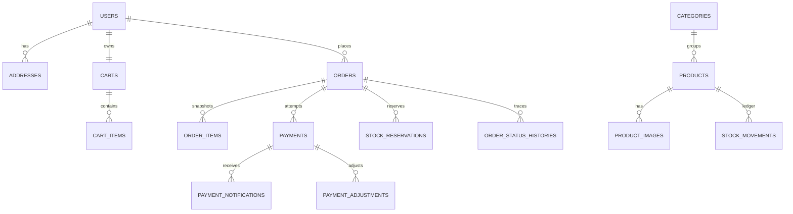

# Model data

SKU, order number, provider order ID, dan event key unik. Unique gabungan melindungi cart item, idempotency customer, reservation, attempt, dan efek ledger. MySQL CHECK menjaga reserved ≤ on hand dan quantity positif.
